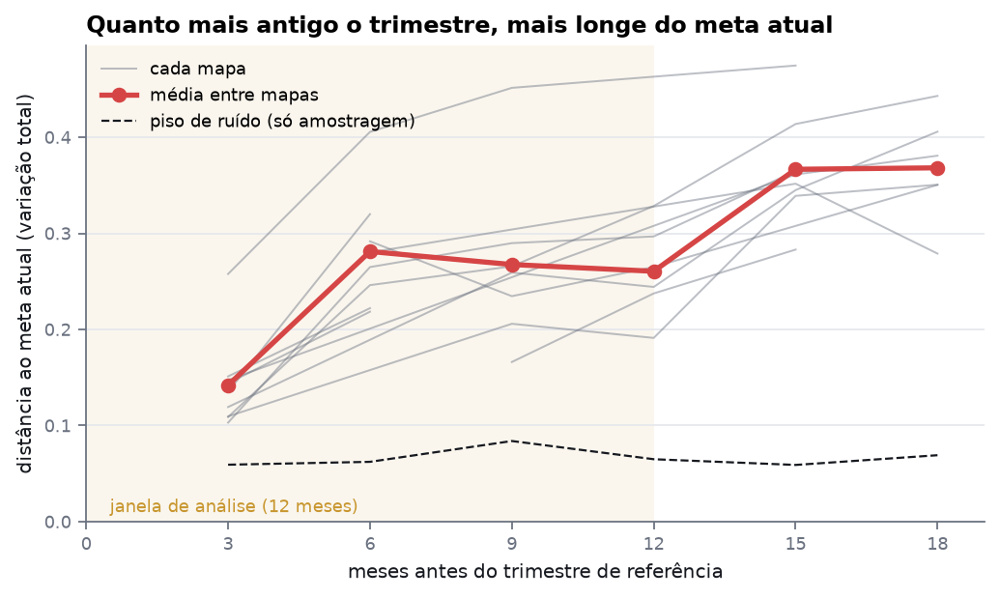

# MetaScope VAL

Análise estatística do competitivo de VALORANT (VCT e VCL), do dado bruto ao site. Pipeline de
coleta próprio sobre a API vlresports, lake em Parquet, warehouse em dbt sobre DuckDB orquestrado
pelo Dagster, rating Elo calibrado e um site estático no GitHub Pages, sem backend (a página de
previsões de confronto fica para a próxima versão).
**Todo número publicado leva intervalo de confiança; quando os dados não decidem, o resultado é
"inconclusivo".**

> Site (v1, sem a página de previsões): <https://joaogalmeidas.github.io/Meta-Scope-VAL/> ·
> Linhagem do dbt em [`/lineage`](https://joaogalmeidas.github.io/Meta-Scope-VAL/lineage/) ·
> Documento mestre: [`docs/projeto-valorant-data.md`](docs/projeto-valorant-data.md)

---

## A tese da janela

Toda análise usa só os **últimos 12 meses**. O motivo: o jogo muda. Mapa por mapa, a distância
entre o meta de agentes de um trimestre e o atual cresce com o tempo, bem acima do que só a
amostragem produziria:



Um trimestre atrás, o meta de um mapa já está a **0,14** do atual (variação total; piso de ruído
0,06). A 12 meses ou mais, a **0,33**. Dado mais antigo descreve outro jogo.

A vantagem de lado, por outro lado, **não** muda entre trimestres além do acaso em nenhum dos 13
mapas: o efeito é de poucos pontos percentuais, e o histórico coletado (desde 2025) não separa a
mudança do ruído. Esse lado da tese volta a ser testado quando o histórico anterior a 2025 for
importado. ([notebook 00](notebooks/00_tese_da_janela_drift.ipynb))

## Resultados

Janela de 14/10/2025 a 07/10/2026: 2.658 séries e 6.397 mapas de VCT e VCL. IC de 95%; correção
de Holm sempre que há várias comparações.

| Pergunta | Resposta | Veredito |
|---|---|---|
| [Algum mapa favorece ataque ou defesa?](notebooks/01_lados_por_mapa.ipynb) | Ataque vence 51,2% (50,8–51,5%) dos rounds 1–24. Abyss 54,1% (52,8–55,5%), Breeze, Haven e Lotus favorecem o ataque; Ascent, a defesa: 47,0% (45,6–48,6%). Sete mapas são inconclusivos. | 5 de 12 mapas |
| [Quanto o pistol decide o mapa?](notebooks/02_pistol.ipynb) | Com Elo igual, quem vence os dois pistols vence o mapa em 73,6% (71,4–75,7%); quem perde os dois, em 28,0% (25,9–30,3%). Razão de chances 7,17 (6,14–8,38). | efeito forte |
| [Escolher o mapa dá vantagem?](notebooks/03_veto.ipynb) | Em 1.405 séries pareadas, quem escolhe vence 51,5% (49,8–53,2%) dos próprios picks. Nenhum mapa tem efeito depois de Holm. | inconclusivo |
| [Alguma região rende diferente do Elo?](notebooks/04_regioes.ipynb) | A China rende abaixo do Elo nos internacionais: −0,29 (−0,41 a −0,14) por série, em 23 séries. Americas, EMEA e Pacific são inconclusivas (61 séries entre regiões). | 1 de 4 |
| [Alguma composição vence acima do esperado?](notebooks/05_meta_composicao.ipynb) | Com controle pela força do time e shrinkage por mapa × patch, 0 de 536 combinações se distinguem do Elo. | inconclusivo |
| [A previsão do Elo é calibrada?](notebooks/07_previsao_calibracao.ipynb) | Log loss 0,661 (0,651–0,671) contra 0,693 da moeda; Brier 0,233. Na VCT, 0,683 (0,657–0,709): indistinguível da moeda. | melhor que a moeda |
| [Quão rápido o meta muda?](notebooks/08_velocidade_do_meta.ipynb) | Em 11 de 12 meses o pick de agentes muda acima do ruído. O pico foi em abril/2026: 0,20 do meta trocado em um mês. | muda todo mês |

O rating (D15) é um Elo sobre o resultado da série, com rating inicial por tier e regressão na
virada de temporada. Quem sobe da VCL para o VCT leva só 10% do que conquistou na VCL: dominar um
circuito quase fechado diz pouco sobre o outro (em 2026, os melhores da VCL jogaram o Stage 2 e
chegavam acima de todo time do VCT). Os parâmetros saíram de uma busca em grade pela log loss
pré-partida, sem treino ([notebook 06](notebooks/06_rating.ipynb)). O ranking da janela é o do site,
que marca como provisório o time com menos de 10 séries do próprio tier.

**Leitura honesta.** Pistol e lado são efeitos claros. Veto e composição não aparecem na amostra
de 12 meses, e isso é resultado: se existem, são menores do que a janela consegue medir. Entre os
times de VCT, a previsão do Elo é indistinguível da moeda. É ali que um modelo treinado pós-D30 teria
de provar valor.

No site, cada análise e o Meta trocam o recorte: a janela inteira ou os últimos 3 meses, e VCT,
VCL ou os dois. Recorte menor tem IC mais largo, e o site diz quando a amostra não basta. O primeiro
achado do recorte: a vantagem de quem escolhe o mapa, inconclusiva na média, aparece só no VCT
(52,8%, IC 95% 50,2–55,4%).

## Arquitetura

```
API vlresports ─► ingestion/ ─────► lake Parquet ──────► dbt + DuckDB ─────────────► marts de análise
  (vlr.gg)        cliente, contrato  season=YYYY/         staging → intermediate →     │
                  Pydantic, ponte    {evento}.parquet     marts (fct/dim) → analysis   │
                  tag → id           espelho no HF        219 testes = asset checks    │
                                                                                       ▼
                     pipeline/elo.py (Python model fct_team_elo)       pipeline/analyses.py + stats.py
                                                                       │                 │
                                                       notebooks/ (matplotlib)   site_artifacts → dist/data/*.json
                                                                                         │
                                                              build_site (Jinja2) → dist/ → GitHub Pages
```

O Dagster define o pipeline (`dagster_defs/`): a coleta é um multi-asset particionado por temporada;
os models do dbt viram assets, e seus testes, asset checks; `site_artifacts` e `site_pages` fecham a
linhagem até o HTML. O GitHub Actions só dispara os jobs `ingest` e `build`.

## Engenharia de dados

- **Contrato na entrada.** Toda resposta da API passa por um contrato Pydantic antes de gravar.
  São 41 pegadinhas da fonte auditadas e documentadas em [`docs/fontes.md`](docs/fontes.md), cada
  uma com fixture real. Mudança de formato quebra um teste, nunca uma análise.
- **Lake idempotente.** Um Parquet por evento, schema fechado e escrita atômica: reescrever o
  arquivo do evento é o upsert. O lake é espelhado num dataset privado do Hugging Face.
- **Warehouse testado.** Staging, intermediate, marts e análise. Os testes unitários do dbt cobrem
  as regras não triviais, e a validação cruzada roda contra o agregado do vlr.gg, com 47 exceções
  escritas, cada uma com motivo. O Elo é sempre pré-partida, com teste anti-vazamento. Nenhum mart
  de análise lê fora da janela, e um teste genérico garante isso.
- **CI em dois trilhos.** Todo push roda lint, 434 testes e o build inteiro (dbt → JSON → HTML)
  sobre um lake gerado dos fixtures, sem segredo. O trilho real (lake-pull → coleta → build →
  Pages) é manual ou semanal.
- **Um número, uma fonte.** Notebooks e site chamam as mesmas funções de `pipeline/analyses.py`.

## Decisões

As decisões estão fechadas e justificadas na seção 2 do documento mestre:
- janela de 12 meses, com a visão de 3 meses e o filtro de tier como recortes no site;
- escopo VCT + VCL, sem o tier 2 chinês;
- coleta própria desde 2025;
- agregado do vlr.gg como gabarito, não como fonte;
- DuckDB como engine, não como banco;
- previsão pelo Elo nos 30 dias, com o modelo treinado só depois.

## Stack

| Camada | Escolha |
|---|---|
| Ambiente | Python 3.12, `uv`, `make` |
| Coleta | `httpx` + `tenacity`, contrato Pydantic |
| Lake | Parquet no Hugging Face Datasets (privado), partição por temporada |
| Warehouse | dbt-core + dbt-duckdb (DuckDB efêmero) |
| Orquestração | Dagster (assets particionados, asset checks) |
| Gatilho | GitHub Actions |
| Análise | pandas, scipy, statsmodels, matplotlib |
| Site | Jinja2, CSS próprio com tokens, ECharts com tema próprio |
| Hospedagem | GitHub Pages |
| ML (pós-D30) | scikit-learn + LightGBM, com o Elo como baseline |

## Começando

```bash
uv sync                 # ambiente
uv run pre-commit install
make dbt-deps           # pacotes do dbt
make test               # pytest (fixtures reais, sem rede)
make build-fixtures     # warehouse + site sobre o lake de fixtures, sem segredo nem rede
make lake-pull          # lake real do Hugging Face (precisa de `hf auth login`)
make build              # warehouse + site + linhagem sobre o lake real → dist/
make notebooks          # reexecuta os notebooks sobre o warehouse
make serve              # dist/ em localhost:8000
```

Alvos disponíveis: `make help`.

**Publicação.** O site sai do CI, não do repositório: o workflow `build` baixa o lake do Hugging
Face, coleta a temporada corrente, roda o `make build` e publica `dist/` no GitHub Pages, à mão ou
toda segunda-feira. O passo a passo para ativar está no D29 do
[documento mestre](docs/projeto-valorant-data.md).

## Estrutura

```
ingestion/     cliente da API, contrato Pydantic, ponte tag → id, coletores, lake
dbt/           staging → intermediate → marts → analysis (o núcleo avaliável)
pipeline/      Elo, estatística, análises, JSONs e gerador do site
dagster_defs/  assets (coleta, dbt, site), checks, jobs
notebooks/     uma análise por pergunta, matplotlib, outputs commitados
web/           templates Jinja2, CSS (tokens), tema do ECharts, JS
dist/          gerado; é o que vai ao ar
docs/          decisões, auditoria da API, imagens do README
```

## Limitações

- O drift de lado usa só o histórico desde 2025. O período anterior virá de um dataset importado à
  parte.
- O patch sai da data da partida. Torneio que trava patch anterior fica mal atribuído.
- Os circuitos quase não se cruzam: comparar Elo entre regiões vale menos que dentro delas, e a
  análise de regiões mostra por quê.
- O tier 2 chinês está fora da coleta: disputado em plataformas de terceiros, chega com dados
  faltando.
- A instância pública da API tem cota compartilhada (~6–12 requisições/min), e a coleta é
  incremental por isso.

## Créditos

Dados do [vlr.gg](https://www.vlr.gg), obtidos pela API open source
[vlresports](https://github.com/Orloxx23/vlresports), de Orloxx23, pela instância pública
`https://vlr.orlandomm.net/api/v1`.

## Aviso

As probabilidades publicadas vêm de um modelo estatístico com fins de portfólio. Não são
recomendação de aposta.

As imagens de mapas e os ícones de agentes são da Riot Games, usados conforme a política de
conteúdo de fãs da Riot ("Legal Jibber Jabber"), sem fins comerciais:

> MetaScope VAL isn't endorsed by Riot Games and doesn't reflect the views or opinions of Riot
> Games or anyone officially involved in producing or managing Riot Games properties. Riot Games,
> and all associated properties are trademarks or registered trademarks of Riot Games, Inc.

## Licença

O código está sob a licença [MIT](LICENSE). Ela não cobre os dados (do vlr.gg, via vlresports)
nem as imagens da Riot Games.
